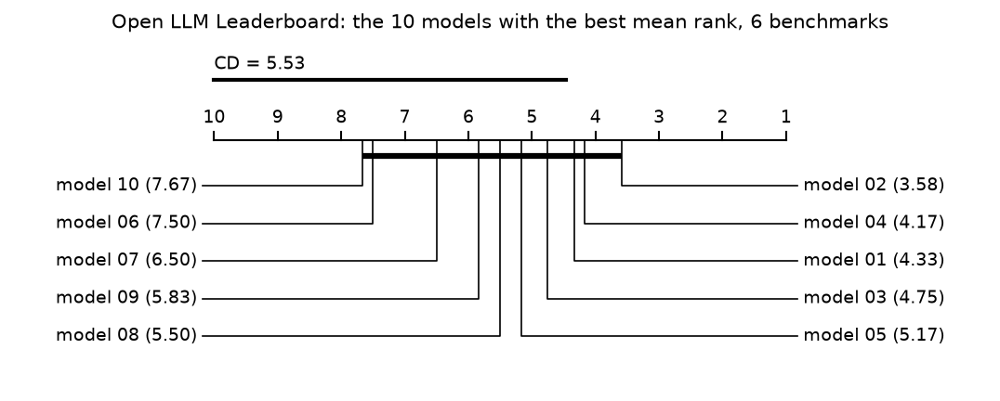

# rankstable

Aggregate model scores over several benchmarks under different published rules and measure how
stable the resulting ranking is to the rule, to dropping a benchmark and to resampling.

## Why this is hard

A leaderboard reduces a models-by-benchmarks table to one order. The reduction (mean score,
mean rank, win rate, Borda count, with or without normalisation) and the choice of benchmarks
are both decisions, and either can change the winner. Dehghani et al. (2021),
[The Benchmark Lottery](https://arxiv.org/abs/2107.07002), report that "the relative
performance of algorithms may be altered significantly simply by choosing different benchmark
tasks". Colombo et al. (2022),
[What are the best systems? New perspectives on NLP Benchmarking](https://arxiv.org/abs/2202.03799),
note that averaging "can be problematic when the metrics are on a different scale" and
aggregate the rankings induced by each task instead. rankstable applies the rules side by side
to your own table and reports how much of the order depends on the rule, on each benchmark and
on the set of models.

## Install

```
pip install git+https://github.com/vipul21435/rankstable
```

Python 3.10 or newer. The only runtime dependency is numpy. The critical-difference diagram
needs matplotlib, which the `plot` extra installs:
`pip install "rankstable[plot] @ git+https://github.com/vipul21435/rankstable"`.

## Quickstart

`examples/toy_scores.csv` is a small made-up table, six models by five benchmarks, in which
one model has a single very high score:

```
model,algebra,code,dialogue,retrieval,summaries
atlas,95.0,61.0,70.5,58.0,66.0
birch,62.0,68.0,74.0,64.5,69.5
cedar,60.0,66.5,73.0,66.0,68.0
dune,58.0,67.0,71.0,63.0,70.0
ember,40.0,69.0,72.5,61.0,67.5
flint,55.0,60.0,69.0,60.0,65.0
```

The arithmetic mean puts `atlas` first:

```
$ rankstable rank examples/toy_scores.csv
Rule: mean (higher is better). 6 models, 5 benchmarks, 0 missing cells.

| rank | model | mean |
|---:|---|---:|
| 1 | atlas | 70.1 |
| 2 | birch | 67.6 |
| 3 | cedar | 66.7 |
| 4 | dune | 65.8 |
| 5 | ember | 62.0 |
| 6 | flint | 61.8 |
```

The mean rank moves it to fifth:

```
$ rankstable rank examples/toy_scores.csv --rule mean-rank
Rule: mean-rank (lower is better). 6 models, 5 benchmarks, 0 missing cells.

| rank | model | mean-rank |
|---:|---|---:|
| 1 | birch | 1.8 |
| 2 | cedar | 2.6 |
| 3 | dune | 3.0 |
| 4 | ember | 3.6 |
| 5 | atlas | 4.4 |
| 6 | flint | 5.6 |
```

`compare-rules` ranks with several rules (all ten by default) and compares the rankings:

```
$ rankstable compare-rules examples/toy_scores.csv --rules mean,geomean,mean-rank,copeland,kemeny
6 models, 5 benchmarks, 0 missing cells.

| rule | top 3 (rank) |
|---|---|
| mean | atlas (1), birch (2), cedar (3) |
| geomean | atlas (1), birch (2), cedar (3) |
| mean-rank | birch (1), cedar (2), dune (3) |
| copeland | birch (1), cedar (2), dune (3) |
| kemeny | birch (1), cedar (2), dune (3) |

Kendall tau-b between the rankings:

| rule | mean | geomean | mean-rank | copeland | kemeny |
|---|---:|---:|---:|---:|---:|
| mean | 1.000 | 0.867 | 0.467 | 0.467 | 0.467 |
| geomean | 0.867 | 1.000 | 0.333 | 0.333 | 0.333 |
| mean-rank | 0.467 | 0.333 | 1.000 | 1.000 | 1.000 |
| copeland | 0.467 | 0.333 | 1.000 | 1.000 | 1.000 |
| kemeny | 0.467 | 0.333 | 1.000 | 1.000 | 1.000 |

Share of the top 3 in common:

| rule | mean | geomean | mean-rank | copeland | kemeny |
|---|---:|---:|---:|---:|---:|
| mean | 1.000 | 1.000 | 0.667 | 0.667 | 0.667 |
| geomean | 1.000 | 1.000 | 0.667 | 0.667 | 0.667 |
| mean-rank | 0.667 | 0.667 | 1.000 | 1.000 | 1.000 |
| copeland | 0.667 | 0.667 | 1.000 | 1.000 | 1.000 |
| kemeny | 0.667 | 0.667 | 1.000 | 1.000 | 1.000 |
```

`stability` leaves benchmarks out, resamples them and removes models:

```
$ rankstable stability examples/toy_scores.csv --rules mean,geomean,mean-rank,copeland --top 3
6 models, 5 benchmarks, 0 missing cells.

Diversity of the benchmark set (mean Kendall distance between benchmark rankings, 0 = same order, 1 = reversed): 0.347

Leave 1 of 5 benchmarks out (all 5 subsets):

| rule | first on the full table | first changes | top 3 changes | mean tau | min tau |
|---|---|---:|---:|---:|---:|
| mean | atlas | 20.0 % | 20.0 % | 0.807 | 0.467 |
| geomean | atlas | 20.0 % | 20.0 % | 0.867 | 0.333 |
| mean-rank | birch | 0.0 % | 20.0 % | 0.973 | 0.966 |
| copeland | birch | 0.0 % | 20.0 % | 0.986 | 0.966 |

Bootstrap over benchmarks (1000 resamples, seed 0):

| rule | first changes | top 3 changes | mean tau | tau 95 % interval |
|---|---:|---:|---:|---:|
| mean | 32.3 % | 40.0 % | 0.697 | 0.136 to 1.000 |
| geomean | 34.3 % | 39.1 % | 0.697 | -0.067 to 1.000 |
| mean-rank | 9.2 % | 40.4 % | 0.840 | 0.552 to 1.000 |
| copeland | 22.7 % | 36.3 % | 0.850 | 0.333 to 1.000 |

Remove one model at a time (every model, 6 removals):

| rule | order of the others changes | pairs changed (mean) | first changes | largest effect |
|---|---:|---:|---:|---|
| mean | 0.0 % | 0.0 % | 0.0 % | none |
| geomean | 0.0 % | 0.0 % | 0.0 % | none |
| mean-rank | 0.0 % | 0.0 % | 0.0 % | none |
| copeland | 0.0 % | 0.0 % | 0.0 % | none |
```

`agreement` correlates each benchmark with the ranking that the other benchmarks give:

```
$ rankstable agreement examples/toy_scores.csv
6 models, 5 benchmarks, 0 missing cells.

Kendall tau-b of each benchmark with the win-rate ranking of the other benchmarks, lowest first (95 % bootstrap interval over models, 1000 resamples, seed 0):

| benchmark | tau | 95 % interval | models |
|---|---:|---:|---:|
| algebra | 0.333 | -0.500 to 1.000 | 6 |
| code | 0.414 | -0.538 to 1.000 | 6 |
| retrieval | 0.690 | -0.091 to 1.000 | 6 |
| summaries | 0.690 | -0.146 to 1.000 | 6 |
| dialogue | 0.828 | 0.289 to 1.000 | 6 |
```

`cd` runs the Friedman test and the Nemenyi critical difference; `--plot FILE` also draws the
diagram:

```
$ rankstable cd examples/toy_scores.csv
6 models, 5 benchmarks, 0 missing cells.

Friedman test: chi-square = 13.114 on 5 degrees of freedom, p = 0.02233. Iman-Davenport F = 4.413 on 5 and 20 degrees of freedom, p = 0.007174.
Nemenyi critical difference at alpha = 0.05: 3.372 mean ranks.

| model | mean rank |
|---|---:|
| birch | 1.800 |
| cedar | 2.600 |
| dune | 3.000 |
| ember | 3.600 |
| atlas | 4.400 |
| flint | 5.600 |

Groups of models whose mean ranks differ by less than the critical difference:

- birch, cedar, dune, ember, atlas
- cedar, dune, ember, atlas, flint
```

Every command takes `--format json`. The same from Python:

```python
from rankstable import aggregate, kendall_tau, leave_out, read_table

table = read_table("examples/toy_scores.csv")
by_mean = aggregate(table, "mean")
by_rank = aggregate(table, "mean-rank")
print(by_mean.order())
print(by_rank.order())
print(round(kendall_tau(by_mean.ranks, by_rank.ranks), 3))
print(leave_out(table, "mean", k=1, top=3).top1_changed)
```

```
['atlas', 'birch', 'cedar', 'dune', 'ember', 'flint']
['birch', 'cedar', 'dune', 'ember', 'atlas', 'flint']
0.467
0.2
```

`examples/compare_rules.py` is a longer runnable script.

## Input

- **Wide CSV or TSV**: one row per model, one column per benchmark; the first column holds the
  model names. An empty cell, or `NA`, `N/A`, `NaN`, `null`, `None` or `-`, is a missing score.
- **Long JSONL**: one object per line with `model`, `benchmark` and `score` (`null` for a
  missing score), and optionally `"higher_is_better": false` for a benchmark where smaller is
  better. Files ending in `.jsonl` or `.ndjson` are read this way; `--input-format` overrides
  the guess.
- `--lower-is-better NAME` marks a benchmark as smaller-is-better; repeat it for several.
- `--missing` chooses what to do with missing cells: `keep` (the default, described below),
  `drop-models`, `drop-benchmarks` or `error`.

## How it works

### Aggregation rules

Write `x_ij` for the score of model `i` on benchmark `j`, and `s_ij` for the same score with
lower-is-better benchmarks negated, so that larger `s` is always better. There are `n` models
and `m` benchmarks; `n_j` models have a score on benchmark `j`. `r_ij` is the rank of model `i`
among them, 1 for the best, tied models sharing the average of their ranks. `w_ik` is the
number of benchmarks on which `i` scores better than `k`.

| rule | value of model `i` | direction |
|---|---|---|
| `mean` | mean over `j` of `s_ij` | higher |
| `minmax` | mean over `j` of `(s_ij - min_j) / (max_j - min_j)` | higher |
| `zscore` | mean over `j` of `(s_ij - mean_j) / sd_j`, with the population standard deviation | higher |
| `geomean` | geometric mean over `j` of `x_ij`, or of `1 / x_ij` on a lower-is-better benchmark | higher |
| `mean-rank` | mean over `j` of `r_ij` | lower |
| `win-rate` | mean over `j` of `(n_j - r_ij) / (n_j - 1)`: the share of the other models beaten, a tie counting half | higher |
| `borda` | sum over `j` of `n_j - r_ij`: one point per model beaten, half a point per tie | higher |
| `copeland` | pairwise contests won minus contests lost; `i` wins its contest with `k` when `w_ik > w_ki` | higher |
| `kemeny` | position of `i` in the order that maximises the sum of `w_ik` over all pairs with `i` placed before `k` | lower |
| `bradley-terry` | `log p_i`, where `p_i / (p_i + p_k)` models the chance that `i` beats `k` on a benchmark | higher |

Where the rules come from, as far as the pages fetched for this README state it:

- Ranking by pairwise comparison instead of by an average is the argument of Peyrard et al.
  (2021), [Better than Average: Paired Evaluation of NLP Systems](https://arxiv.org/abs/2110.10746),
  who advocate "aggregation methods based on pairwise comparisons, such as the Bradley-Terry
  (BT) model". They work with instance-level scores inside one benchmark; here a "contest" is
  a whole benchmark.
- Aggregating per-task rankings with rules from social choice theory is proposed by Colombo et
  al. (2022, above) and by Rofin et al.,
  [Vote'n'Rank: Revision of Benchmarking with Social Choice Theory](https://arxiv.org/abs/2210.05769),
  "a framework for ranking systems in multi-task benchmarks under the principles of the social
  choice theory". Borda, Copeland and Kemeny-Young are implemented here from their textbook
  definitions.
- The win rate follows the idea of the head-to-head win rate of Liang et al. (2022),
  [Holistic Evaluation of Language Models](https://arxiv.org/abs/2211.09110), whose Figure 26
  reports "the fraction of head-to-head comparisons between the given model and all other
  models, across all scenarios, where the given model is higher along the metric". rankstable
  differs in two documented ways: it averages the per-benchmark fractions, and it counts a tie
  as half a win.
- Mean ranks, the Friedman test, the Nemenyi critical difference and the diagram follow Demsar
  (2006), [Statistical Comparisons of Classifiers over Multiple Data Sets](https://jmlr.org/papers/v7/demsar06a.html).

On a table without missing cells `borda = m * (n - mean-rank)` and
`win-rate = borda / (m * (n - 1))`, so these three rules always give the same order there.
`bradley-terry` joins them, because every pair of models then meets equally often. They
differ once cells are missing.

**Kemeny-Young.** With at most 12 models the best order is found exactly, by dynamic
programming over subsets of models (`2^n * n` steps). Above that a local search is used: start
from the order by total pairwise wins and move one model at a time to the position that
raises the objective most, until no single move helps. That result is a heuristic without an
optimality guarantee. Several orders can be equally good (three in a Condorcet cycle); the
alphabetically first is reported, so `kemeny` never shows ties.

**Bradley-Terry.** Each benchmark is a round of contests between the models scored on it; a
tie is half a win for each side. The strengths are fitted with the
minorisation-maximisation update `p_i <- W_i / sum_k N_ik / (p_i + p_k)`, where `W_i` are the
wins of `i` and `N_ik` the contests between `i` and `k`. Half a win and half a loss against a
virtual opponent of strength 1 are added for every model, which keeps the fit finite when a
model wins or loses everything.

**Missing cells.** With `--missing keep` every rule uses the cells that are present. The
means run over the benchmarks a model has a score on, and the minimum, maximum, mean and
standard deviation of a benchmark are taken over the models that have a score on it. Ranks
on a benchmark cover only the models scored there. `mean-rank` averages those ranks as they
are, so a rank on a benchmark that few models were run on counts like the same rank on a
full one; `win-rate` divides by the number of opponents and does not have this problem.
`borda` sums points, so a benchmark without a score gives a model nothing. `copeland`,
`kemeny` and `bradley-terry` compare two models on the benchmarks both have. A model without
any score has no value and is ranked last.

**Ties.** On one benchmark two models are tied when their scores are equal. In the final
ranking two models are tied when their values differ by no more than 1e-12 of the largest
value or term involved, so that rounding error does not order models that are equal on paper.
Tied models share the smallest rank (1, 2, 2, 4) and are listed alphabetically.

**Other conventions.** A benchmark on which all scores are equal has no spread to normalise
and is skipped by `minmax` and `zscore`. `geomean` needs non-negative scores; a zero on a
higher-is-better benchmark makes the geometric mean zero, and a zero on a lower-is-better
benchmark is an error. A command that runs several rules leaves out a rule that cannot use
the table and says so.

### Comparing rules

**Kendall's tau-b** between two rankings is `(C - D) / sqrt((P - T1) * (P - T2))`, where `C`
and `D` count the concordant and discordant pairs of models, `P = n(n-1)/2` is the number of
pairs, and `T1`, `T2` count the pairs tied in the first and in the second ranking. It is 1
for identical orders, -1 for reversed ones and undefined (`n/a`) when a ranking is constant.
Pairs are counted with a merge sort in `O(n log^2 n)`.

**Top-k overlap** is `|A & B| / max(|A|, |B|)`, where `A` and `B` hold the models ranked `k`
or better by each rule. A tie at the boundary puts every tied model in the set, so a set can
have more than `k` members.

### Stability

- **Leave k benchmarks out.** Every subset of `k` benchmarks is removed in turn (all
  `C(m, k)` subsets up to `--max-subsets`, a seeded sample beyond) and the models are ranked
  again. Reported per rule: the share of subsets after which the set of first-ranked models
  differs, the share after which the top-k set differs, and the mean and minimum tau-b with
  the full ranking.
- **Bootstrap over benchmarks.** `m` benchmarks are drawn with replacement, so some count
  twice and some drop out; the same shares are reported over the resamples, with a
  percentile interval for tau-b. The JSON output adds, per model, the share of resamples in
  which it is first and in the top k, and a percentile interval for its rank.
- **Removing a model.** Each model is removed in turn (a seeded sample above `--removals`
  models) and the others are ranked again. A rule that is independent of irrelevant
  alternatives leaves their relative order alone. Reported: the share of removals after
  which some pair of the remaining models is ordered differently, the mean share of pairs
  affected, and the share of removals after which the first place among the remaining models
  goes to someone else.
- **Diversity.** The Kendall distance `(1 - tau_b) / 2` between the rankings of two
  benchmarks, averaged over all pairs of benchmarks: 0 when all benchmarks order the models
  the same way, 1 when they reverse each other. Zhang and Hardt (2024),
  [Inherent Trade-Offs between Diversity and Stability in Multi-Task Benchmarks](https://arxiv.org/abs/2405.01719),
  find that "The more diverse a multi-task benchmark, the more sensitive to trivial changes
  it is", with diversity capturing "the degree of disagreement in model rankings across
  tasks" and ordinal rules being sensitive "to the inclusion of irrelevant models". The
  number printed here is a plain pairwise proxy shown beside the sensitivity figures above;
  it is not the diversity measure defined in their paper.

### Benchmark agreement

For each benchmark, the other benchmarks are aggregated (with `win-rate` unless `--rule` says
otherwise) and Kendall's tau-b is taken between that ranking and the scores on the benchmark,
over the models that have both. A low value marks a benchmark that orders the models unlike
the rest. The interval is a percentile bootstrap over models. Perlitz et al. (2024),
[Do These LLM Benchmarks Agree? Fixing Benchmark Evaluation with BenchBench](https://arxiv.org/abs/2407.13696),
describe this kind of check as benchmark agreement testing, "where new benchmarks are
validated against established ones using some agreement metric (e.g., rank correlation)", and
show that the methodological choices behind it change its results.

### Friedman test and critical difference

With `N` benchmarks, `k` models and mean ranks `R_i`, Friedman's statistic is
`chi2 = 12 N / (k (k + 1)) * (sum R_i^2 - k (k + 1)^2 / 4)`, divided by the usual tie
correction `1 - sum (t^3 - t) / (N k (k^2 - 1))`, on `k - 1` degrees of freedom. The
Iman-Davenport statistic `F = (N - 1) chi2 / (N (k - 1) - chi2)` has `k - 1` and
`(k - 1)(N - 1)` degrees of freedom. Two models differ significantly by the Nemenyi test when
their mean ranks differ by at least `CD = q_alpha * sqrt(k (k + 1) / (6 N))`. `q_alpha` is
computed for any `k` as the upper `alpha` point of the range of `k` standard normal
variables divided by `sqrt(2)`, by numerical integration; it reproduces Table 5(a) of Demsar
(2006) to the three decimals printed there. In the diagram the axis is turned as in that
paper, "so that the lowest (best) ranks are to the right", and a bar joins models that the
test does not separate. The p-values use this package's own incomplete gamma and beta
functions and are tested against scipy.

## Results on real public data

**Data.** The results table of the Open LLM Leaderboard, dataset
[`open-llm-leaderboard/contents`](https://huggingface.co/datasets/open-llm-leaderboard/contents)
on Hugging Face, downloaded on 2026-11-13 (the Hub reports its last modification as
2025-03-20). The dataset page states no licence, so the table is not in this repository;
`examples/fetch_open_llm_leaderboard.py` downloads it, and only numbers derived from it are
shown. Model names are left out of the tables below. The table has **4,576 models and 6
benchmarks** (IFEval, BBH, MATH Lvl 5, GPQA, MUSR, MMLU-PRO, in the normalised form that the
leaderboard averages) and no missing cells.

```
python examples/fetch_open_llm_leaderboard.py open_llm_leaderboard.csv
```

**Kendall's tau between rules.** Over all 4,576 models, tau-b between two rules ranges from
0.859 (`mean` against `geomean`) to 1. Part of that lowest value comes from zero scores: 332
models have a zero on some benchmark and tie for last place under `geomean`, and without them
the figure is 0.864 (details below the tables). `mean-rank`, `win-rate`, `borda` and
`bradley-terry` coincide, as they must on a complete table. The first place goes to one model under `mean`, `minmax`, `zscore`, `geomean`
and `copeland`, to a second model under `mean-rank`, `win-rate`, `borda` and `bradley-terry`,
and to a third under `kemeny`, which at this size is the local-search heuristic.

```
rankstable compare-rules open_llm_leaderboard.csv --top 5
```

Kendall tau-b between the rankings:

| rule | mean | minmax | zscore | geomean | mean-rank | win-rate | borda | copeland | kemeny | bradley-terry |
|---|---:|---:|---:|---:|---:|---:|---:|---:|---:|---:|
| mean | 1.000 | 0.928 | 0.897 | 0.859 | 0.888 | 0.888 | 0.888 | 0.866 | 0.860 | 0.888 |
| minmax | 0.928 | 1.000 | 0.968 | 0.907 | 0.944 | 0.944 | 0.944 | 0.914 | 0.902 | 0.944 |
| zscore | 0.897 | 0.968 | 1.000 | 0.915 | 0.953 | 0.953 | 0.953 | 0.920 | 0.906 | 0.953 |
| geomean | 0.859 | 0.907 | 0.915 | 1.000 | 0.919 | 0.919 | 0.919 | 0.899 | 0.884 | 0.919 |
| mean-rank | 0.888 | 0.944 | 0.953 | 0.919 | 1.000 | 1.000 | 1.000 | 0.935 | 0.915 | 1.000 |
| win-rate | 0.888 | 0.944 | 0.953 | 0.919 | 1.000 | 1.000 | 1.000 | 0.935 | 0.915 | 1.000 |
| borda | 0.888 | 0.944 | 0.953 | 0.919 | 1.000 | 1.000 | 1.000 | 0.935 | 0.915 | 1.000 |
| copeland | 0.866 | 0.914 | 0.920 | 0.899 | 0.935 | 0.935 | 0.935 | 1.000 | 0.968 | 0.935 |
| kemeny | 0.860 | 0.902 | 0.906 | 0.884 | 0.915 | 0.915 | 0.915 | 0.968 | 1.000 | 0.915 |
| bradley-terry | 0.888 | 0.944 | 0.953 | 0.919 | 1.000 | 1.000 | 1.000 | 0.935 | 0.915 | 1.000 |

Share of the top 5 in common:

| rule | mean | minmax | zscore | geomean | mean-rank | win-rate | borda | copeland | kemeny | bradley-terry |
|---|---:|---:|---:|---:|---:|---:|---:|---:|---:|---:|
| mean | 1.000 | 0.667 | 0.667 | 0.667 | 0.800 | 0.800 | 0.800 | 0.600 | 0.400 | 0.800 |
| minmax | 0.667 | 1.000 | 1.000 | 1.000 | 0.667 | 0.667 | 0.667 | 0.833 | 0.667 | 0.667 |
| zscore | 0.667 | 1.000 | 1.000 | 1.000 | 0.667 | 0.667 | 0.667 | 0.833 | 0.667 | 0.667 |
| geomean | 0.667 | 1.000 | 1.000 | 1.000 | 0.667 | 0.667 | 0.667 | 0.833 | 0.667 | 0.667 |
| mean-rank | 0.800 | 0.667 | 0.667 | 0.667 | 1.000 | 1.000 | 1.000 | 0.600 | 0.400 | 1.000 |
| win-rate | 0.800 | 0.667 | 0.667 | 0.667 | 1.000 | 1.000 | 1.000 | 0.600 | 0.400 | 1.000 |
| borda | 0.800 | 0.667 | 0.667 | 0.667 | 1.000 | 1.000 | 1.000 | 0.600 | 0.400 | 1.000 |
| copeland | 0.600 | 0.833 | 0.833 | 0.833 | 0.600 | 0.600 | 0.600 | 1.000 | 0.800 | 0.600 |
| kemeny | 0.400 | 0.667 | 0.667 | 0.667 | 0.400 | 0.400 | 0.400 | 0.800 | 1.000 | 0.400 |
| bradley-terry | 0.800 | 0.667 | 0.667 | 0.667 | 1.000 | 1.000 | 1.000 | 0.600 | 0.400 | 1.000 |

**Zero scores under `geomean`.** 332 of the 4,576 models have a zero on at least one
benchmark (GPQA 241, MATH Lvl 5 134, IFEval 7, MUSR 1, MMLU-PRO 1). `geomean` gives each of
them 0, so they all share rank 4,245, the last place. That tie is part of what separates
`geomean` from the other rules, but a small part: with those 332 models left out, tau-b
between `mean` and `geomean` is 0.864 instead of 0.859, and the values against the other
rules rise by about 0.01.

```
python examples/table_checks.py open_llm_leaderboard.csv
```

```
4576 models, 6 benchmarks
models with a zero score on at least one benchmark: 332
  per benchmark: IFEval 7, BBH 0, MATH Lvl 5 134, GPQA 241, MUSR 1, MMLU-PRO 1
  models with a geometric mean of zero: 332, sharing rank 4245 of 4576
Kendall tau-b between geomean and other rules: all 4576 models / the 4244 models without a zero score
  mean       0.859 / 0.864
  minmax     0.907 / 0.917
  zscore     0.915 / 0.926
  mean-rank  0.919 / 0.927
  copeland   0.899 / 0.907
```

**Leave benchmarks out.** Dropping one of the six benchmarks changes the first place in 1 of
6 cases under `mean` and `geomean`, in none under `minmax` and `zscore`, in 2 of 6 under the
rank-based rules and in 5 of 6 under `copeland`. The top five change in 1 of 6 cases
(`minmax`) to 5 of 6 (`copeland`).

```
rankstable stability open_llm_leaderboard.csv --top 5 --resamples 0 --removals 0 --leave-out 1,2 \
  --rules mean,minmax,zscore,geomean,mean-rank,win-rate,borda,copeland
```

Leave 1 of 6 benchmarks out (all 6 subsets):

| rule | first changes | top 5 changes | mean tau | min tau |
|---|---:|---:|---:|---:|
| mean | 16.7 % | 66.7 % | 0.932 | 0.846 |
| minmax | 0.0 % | 16.7 % | 0.933 | 0.885 |
| zscore | 0.0 % | 50.0 % | 0.933 | 0.901 |
| geomean | 16.7 % | 33.3 % | 0.935 | 0.893 |
| mean-rank | 33.3 % | 66.7 % | 0.934 | 0.908 |
| win-rate | 33.3 % | 66.7 % | 0.934 | 0.908 |
| borda | 33.3 % | 66.7 % | 0.934 | 0.908 |
| copeland | 83.3 % | 83.3 % | 0.940 | 0.939 |

Leave 2 of 6 benchmarks out (all 15 subsets):

| rule | first changes | top 5 changes | mean tau | min tau |
|---|---:|---:|---:|---:|
| mean | 20.0 % | 93.3 % | 0.882 | 0.789 |
| minmax | 33.3 % | 60.0 % | 0.887 | 0.828 |
| zscore | 33.3 % | 53.3 % | 0.887 | 0.845 |
| geomean | 33.3 % | 73.3 % | 0.890 | 0.838 |
| mean-rank | 60.0 % | 86.7 % | 0.892 | 0.852 |
| win-rate | 60.0 % | 86.7 % | 0.892 | 0.852 |
| borda | 60.0 % | 86.7 % | 0.892 | 0.852 |
| copeland | 73.3 % | 73.3 % | 0.903 | 0.869 |

**Bootstrap over benchmarks and removal of models.** With benchmarks resampled, the first
place changes in about a third of the resamples under the score-based rules and in two
thirds under the rank-based ones; the top five change in 71 % to 96 %. Removing one model
never reorders the others under `mean` and `geomean`. Under `minmax` it can, when the removed
model holds a benchmark's minimum or maximum, which happened in none of the 200 sampled
removals. Under `zscore` and the rank-based rules almost every removal reorders some pair,
but only a small share of the pairs, and the first place never moved in this sample.

```
rankstable stability open_llm_leaderboard.csv --top 5 --resamples 1000 --removals 200 \
  --rules mean,minmax,zscore,geomean,mean-rank,win-rate,borda
```

Bootstrap over benchmarks (1000 resamples, seed 0):

| rule | first changes | top 5 changes | mean tau | tau 95 % interval |
|---|---:|---:|---:|---:|
| mean | 34.4 % | 95.7 % | 0.867 | 0.742 to 0.968 |
| minmax | 33.8 % | 71.2 % | 0.869 | 0.750 to 0.964 |
| zscore | 34.5 % | 71.4 % | 0.867 | 0.754 to 0.966 |
| geomean | 35.2 % | 70.6 % | 0.872 | 0.754 to 0.976 |
| mean-rank | 66.5 % | 81.9 % | 0.870 | 0.756 to 0.963 |
| win-rate | 66.5 % | 81.9 % | 0.870 | 0.756 to 0.963 |
| borda | 66.5 % | 81.9 % | 0.870 | 0.756 to 0.963 |

Remove one model at a time (a sample of models, 200 removals):

| rule | order of the others changes | pairs changed (mean) | first changes |
|---|---:|---:|---:|
| mean | 0.0 % | 0.0 % | 0.0 % |
| minmax | 0.0 % | 0.0 % | 0.0 % |
| zscore | 99.5 % | 0.00074 % | 0.0 % |
| geomean | 0.0 % | 0.0 % | 0.0 % |
| mean-rank | 100.0 % | 0.0029 % | 0.0 % |
| win-rate | 100.0 % | 0.0029 % | 0.0 % |
| borda | 100.0 % | 0.0029 % | 0.0 % |

The diversity of the six benchmarks, printed by the same command, is 0.235.

**Which benchmark agrees least with the rest.** IFEval, with tau-b 0.451 (95 % interval 0.436
to 0.467) against the win-rate ranking of the other five; MUSR is close behind. MMLU-PRO
agrees most.

```
rankstable agreement open_llm_leaderboard.csv
```

| benchmark | tau | 95 % interval | models |
|---|---:|---:|---:|
| IFEval | 0.451 | 0.436 to 0.467 | 4576 |
| MUSR | 0.483 | 0.471 to 0.497 | 4576 |
| MATH Lvl 5 | 0.636 | 0.624 to 0.647 | 4576 |
| GPQA | 0.647 | 0.637 to 0.658 | 4576 |
| BBH | 0.774 | 0.767 to 0.781 | 4576 |
| MMLU-PRO | 0.787 | 0.781 to 0.794 | 4576 |

**Critical difference.** For the ten models with the best mean rank the Friedman test does
not reject equal mean ranks, and the Nemenyi critical difference of 5.53 ranks is wider than
the whole spread of their mean ranks: six benchmarks do not separate any of them.

```
python examples/cd_figure.py open_llm_leaderboard.csv docs/cd_open_llm_top10.png --top 10 \
  --title "Open LLM Leaderboard: the 10 models with the best mean rank, 6 benchmarks"
```

```
10 models, 6 benchmarks: chi-square 11.330 (p = 0.2538), critical difference 5.530
not separated: model 02, model 04, model 01, model 03, model 05, model 08, model 09, model 07, model 06, model 10
```



The labels give each model's position by mean rank on the full table. Ranked among the ten
alone, `model 02` comes first: the mean rank of a model depends on which other models are
in the table. `rankstable cd open_llm_leaderboard.csv --top 10 --plot FILE` draws the same
figure with the model names.

**Running time** on a busy 8-core laptop: `compare-rules` with all ten rules took 2 min 38 s,
most of it in `kemeny` and `bradley-terry`; the `stability` run with 1000 resamples took
2 min 20 s and `agreement` 1 min 13 s.

## Limitations

- **Kemeny-Young is exact only up to 12 models.** Above that the result comes from a local
  search and may not be the best order; every number for `kemeny` on the real table is from
  that heuristic. When several orders are equally good only one is reported.
- **Pairwise rules are slow on large tables.** `copeland`, `kemeny` and `bradley-terry` build
  an `n`-by-`n` matrix. On 4,576 models that made `kemeny` and `bradley-terry` too slow to
  put inside the bootstrap, so the real-data bootstrap above covers seven rules, and the
  leave-out run eight.
- **Six benchmarks are few.** A bootstrap over six benchmarks is coarse, its intervals are
  plain percentile intervals, and each benchmark is treated as one exact number per model:
  noise inside a benchmark is not modelled.
- **Adding a model is not simulated.** The sensitivity to the set of models is measured by
  removing models that are in the table; it reads as the effect of adding the same model to
  the table without it. No hypothetical models are generated.
- **Agreement intervals** resample the models but keep the aggregate of the other benchmarks
  fixed inside a resample, so they understate the uncertainty of that aggregate.
- **The diversity number is a proxy**, the mean pairwise Kendall distance. The measures that
  Zhang and Hardt define are not implemented.
- **The Friedman test needs a complete table**, and the Nemenyi critical value assumes the
  usual infinite degrees of freedom. With thousands of models and a handful of benchmarks
  the critical difference is larger than any difference in the table.
- **A zero sinks a model under `geomean`.** One zero score gives a geometric mean of zero
  whatever the other scores are, and all such models tie. On the real table that is 332
  models, 7 % of the entries.
- **Missing cells are never imputed.** Each rule handles them as described above, and the
  rules differ in how much a missing benchmark costs a model.
- **The real-data numbers describe one snapshot** of one leaderboard, in which many entries
  are variants of the same base model.
- Inputs are tables of final scores. Instance-level scores and the uncertainty inside one
  benchmark are out of scope; see evalstats below.

## Related tools

- [evalstats](https://github.com/vipul21435/evalstats) works inside one benchmark: error
  bars and paired comparisons for model evaluations. rankstable starts where it stops, from
  one score per model and benchmark.
- [prefpairs](https://github.com/vipul21435/prefpairs) stores pairwise human preference
  judgments and fits Bradley-Terry and Elo rankings to them, with bootstrap intervals. The
  Bradley-Terry fit here is a small one on benchmark-level wins; use prefpairs for
  preference data.
- BenchBench, the Python package introduced by Perlitz et al. (2024, above), is built for
  benchmark agreement testing against many reference benchmarks.

## Development

```
uv run --extra dev pytest -q
uv run --extra dev ruff check .
```

178 tests; the full run took between 25 and 99 seconds here, on a machine shared with other
jobs. Statement coverage is 99 %
(`uv run --extra dev pytest --cov=rankstable`).
The tests check every rule against profiles worked by hand, including a Condorcet cycle; the
exact Kemeny-Young order against brute force over all permutations for up to seven models;
Kendall's tau-b, ranks, z-scores, geometric means, the Friedman statistic, the chi-square and
F tail probabilities and the Nemenyi critical values against scipy; Bradley-Terry against a
direct optimiser; and invariance to the order of models and benchmarks. scipy is needed for
the tests only, matplotlib for the tests and the diagram.

## Licence

MIT, see [LICENSE](LICENSE).

Built by Vipul Raj Jha · https://vipul21435.github.io
